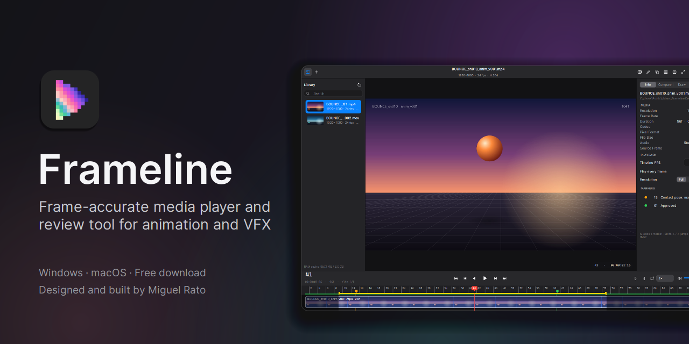
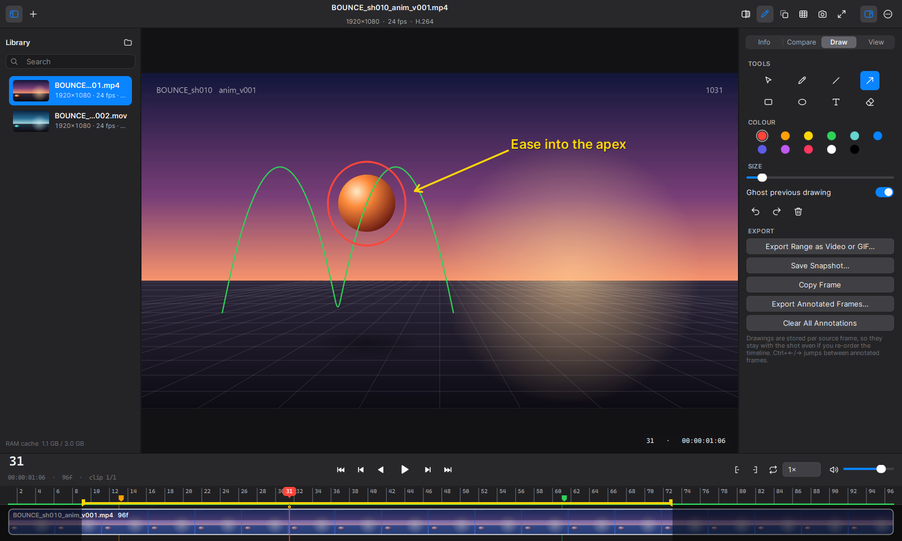
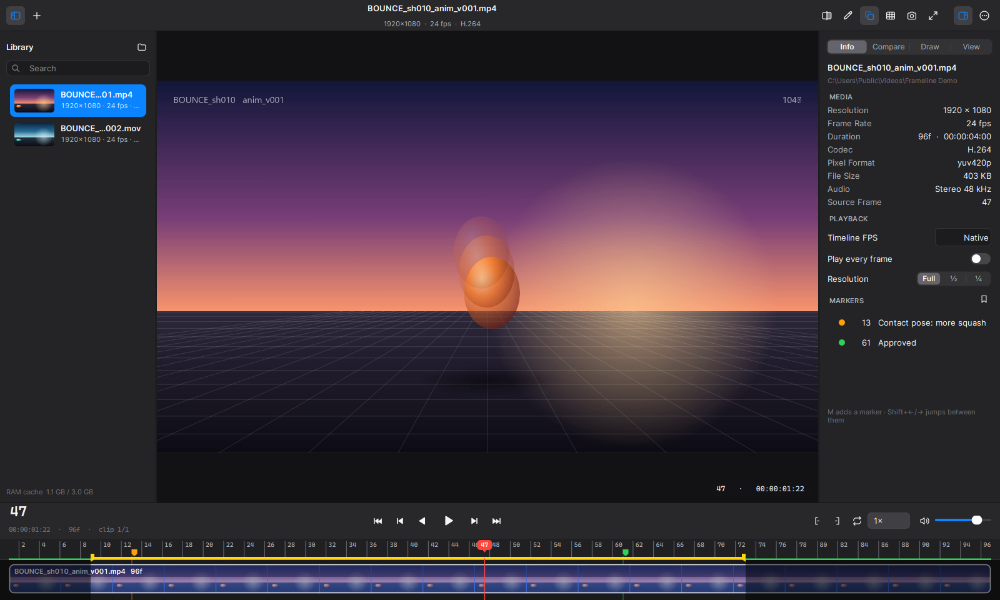
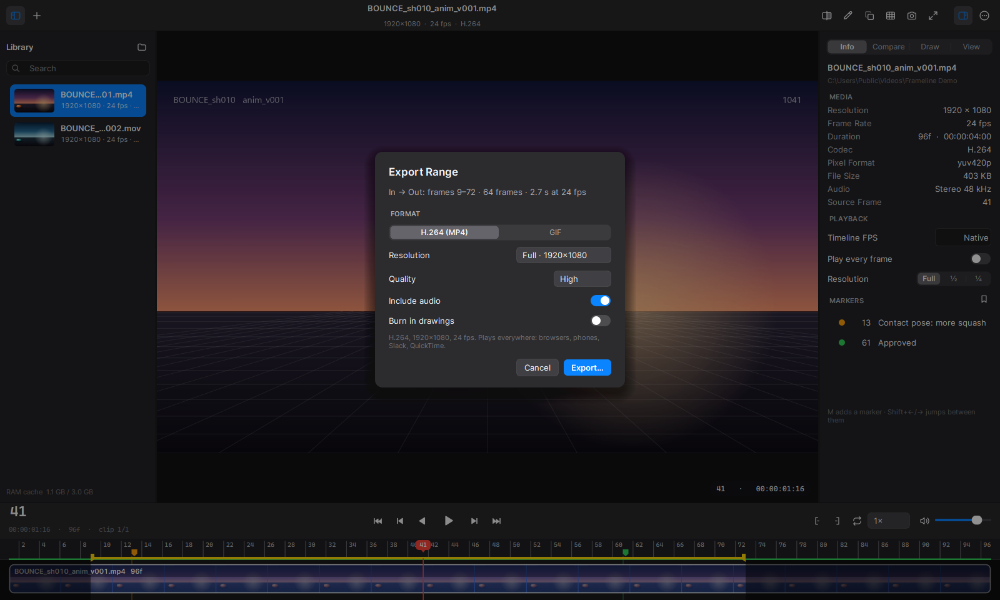
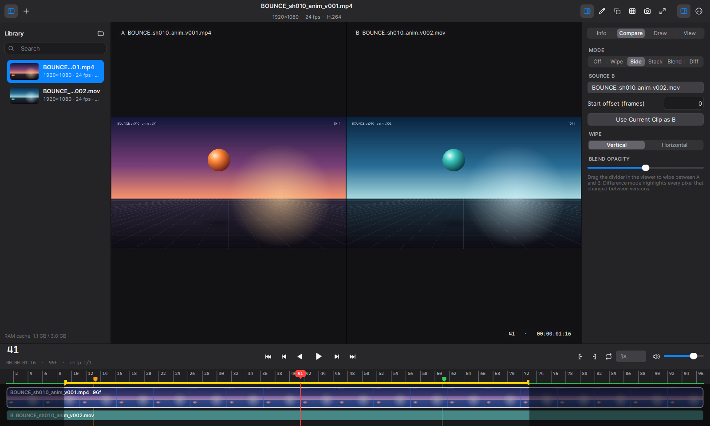
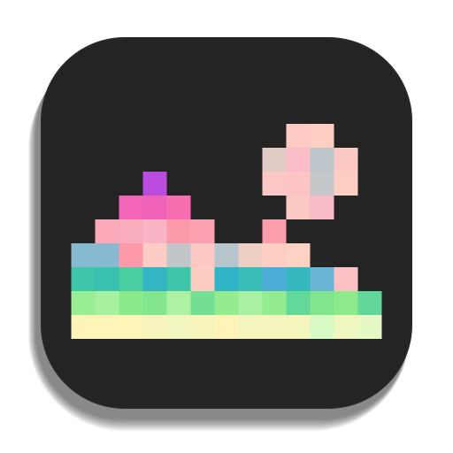
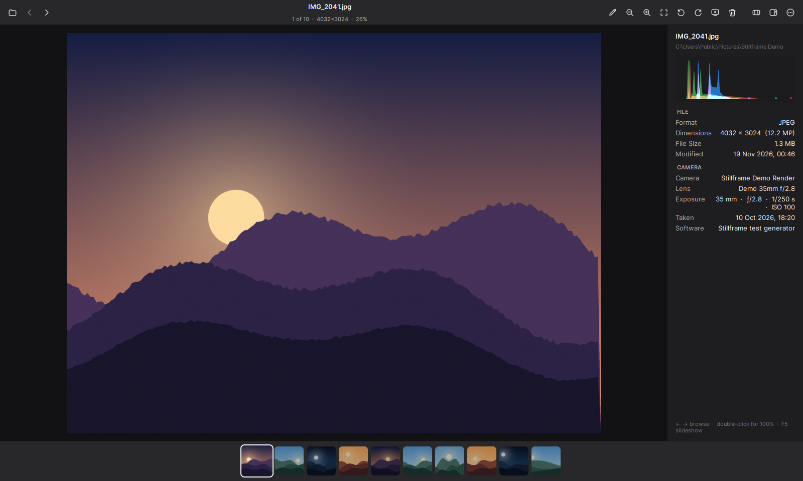
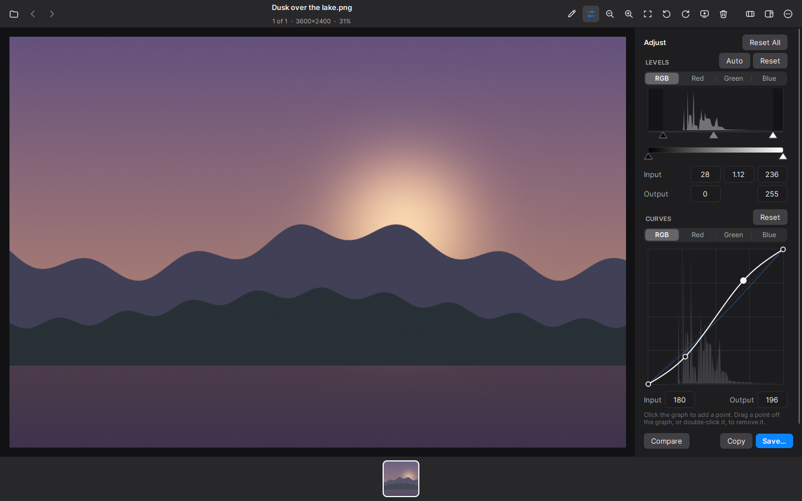
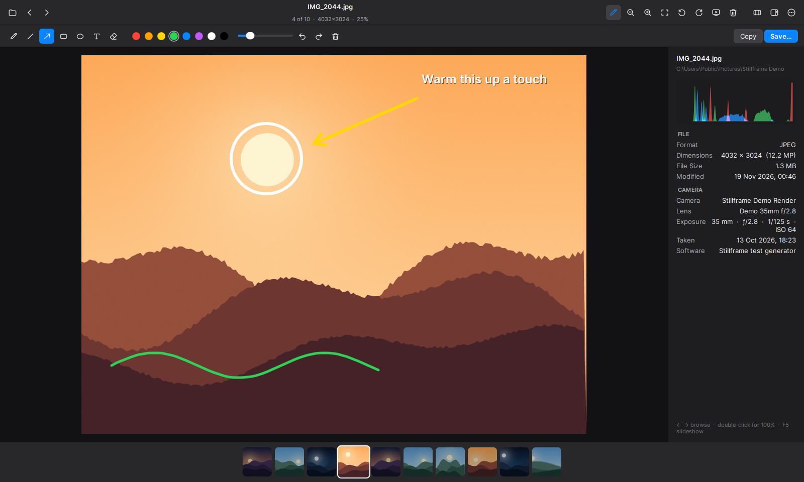

<p align="center"></p>

# Frameline

A frame-accurate media player and review tool for animation and VFX, with a macOS-inspired interface.
Runs on Windows and macOS.

**Designed and built by Miguel Rato.**

This repository holds two apps that share one design:
- **Frameline:** the video player and review tool described below.
- **[Stillframe](#stillframe):** a fast, simple photo viewer with markup.

<p align="center"></p>

## Screenshots

| | |
| --- | --- |
| <br>**Compare versions** with a draggable wipe, side by side, stacked, blend or difference. | <br>**Draw notes** on any frame with pen, shapes, arrows and text. Notes stay with the source frame. |
| <br>**Onion skin** shows the frames either side of the current one, so you can check spacing and arcs. | <br>**Export a range** as an H.264 MP4 or a GIF at full resolution, with drawings burned in. |
| <br>**Side by side** comparison of two versions. | |

## Stillframe

<p align="center"></p>

A fast, simple photo viewer built on the same design as Frameline. Open any photo and the whole folder is ready to browse. The next and previous photos are decoded in the background, so flipping between them is instant.

<p align="center"></p>

| | |
| --- | --- |
| <br>**Levels and Curves:** set black, white and midtone points, or shape tone curves for RGB or each colour channel separately, with live histograms and before/after compare. | <br>**Markup:** sketch, draw lines, arrows, boxes and circles, or add text, then **Copy** the result to the clipboard or **Save…** a marked-up copy. The original photo is never changed. |

**Editing quality:**
- **Colour:** adjustments work on the photo's own pixels and colour profile (sRGB, Display P3, Adobe RGB), and saved files keep that profile and the camera EXIF.
- **Bit depth:** 16-bit PNG and TIFF files stay 16-bit.
- **JPEG:** saved at quality 95 with full 4:4:4 colour.

**Paste:** press **Ctrl+V** to open an image from the clipboard, such as a screenshot. You can then adjust it, mark it up, copy it or save it.

| | |
| --- | --- |
| **Formats:** JPEG, PNG, HEIC/HEIF (iPhone), AVIF, WebP, GIF (animated), TIFF, BMP, SVG, PSD, EXR and more.<br><br>**Viewing:** fit, 100% and smooth zoom to the cursor, rotation that follows the camera, wide-gamut colour converted to your screen, filmstrip, slideshow and full screen.<br><br>**Info:** dimensions, file size, camera, lens and exposure, and a live RGB histogram.<br><br>**Files:** rotate and save, copy, save a copy, show in folder, and delete to the Recycle Bin or Trash. |

Stillframe's shortcuts:
- **Browse:** ← →
- **Zoom:** double-click switches between Fit and 100%.
- **Adjust (Levels and Curves):** **Ctrl+M**. Hold **\\** to compare with the original.
- **Markup:** **M**, then **Ctrl+C** to copy or **Ctrl+S** to save.
- **Paste an image:** **Ctrl+V**.
- **Slideshow:** **F5**.
- **Full list:** press **F1**.

## Download

Get the latest version from the [Releases page](https://github.com/iamgraphicartist/frameline/releases/latest).

| Platform | Frameline (video) | Stillframe (photos) |
| --- | --- | --- |
| Windows 10/11 (installer) | `Frameline-Setup-<version>.exe` | `Stillframe-Setup-<version>.exe` |
| Windows (portable, no install) | `Frameline-<version>-Windows-Portable.exe` | `Stillframe-<version>-Windows-Portable.exe` |
| Mac with Apple Silicon (M1 or later) | `Frameline-<version>-macOS-AppleSilicon.dmg` | `Stillframe-<version>-macOS-AppleSilicon.dmg` |
| Mac with Intel | `Frameline-<version>-macOS-Intel.dmg` | `Stillframe-<version>-macOS-Intel.dmg` |

### Installing on Windows
Run the installer. It doesn't need admin rights. It adds the app to the Start menu and to **Open with** for its file types.
- **Make it your default:** right-click a video (or a photo, for Stillframe) and choose **Open with → Choose another app**.
  1. Pick the app. If it isn't listed, click **Choose an app on your PC** and select `Frameline.exe` or `Stillframe.exe` in `%LOCALAPPDATA%\Programs\<App>`.
  2. Tick **Always**.

  The app's **⋯ → Set as Default…** menu item copies that location for you.
- **"Windows protected your PC":** the app isn't code-signed, so Windows may show this message. Click **More info → Run anyway**.

### Installing on macOS
Open the `.dmg` and drag the app into **Applications**.
- **First launch:** the app isn't notarised by Apple, so the first time open it with right-click → **Open** → **Open**. On macOS 15 and later, use **System Settings → Privacy & Security → Open Anyway** instead.
- **Make it your default:** select a file in Finder and press **⌘I**. Choose the app under **Open with**, then click **Change All…**.

## Frameline features
- **Playback:** H.264/H.265, ProRes, DNxHD, VP9, AV1 and more via FFmpeg, plus image sequences (PNG, JPG, TIFF, EXR, DPX…, numbering detected automatically) and stills. Frames are cached in RAM (a green bar shows what's cached).
- **Transport:** forward and reverse play, J/K/L shuttle, 0.1×–8× speed, step one frame at a time, loop / ping-pong / play-once, in/out play range, timeline FPS override, "play every frame" mode, ½ and ¼ proxy resolution.
- **Timeline:** combine several clips into one sequence, re-order them with Ctrl+drag, set hold length for stills, add colour markers with notes.
- **Compare A/B:** wipe (vertical or horizontal), side-by-side, stacked, blend and difference, with a frame offset for B.
- **Annotate:** pen, line, arrow, rectangle, ellipse, text and eraser, 11 colours, undo/redo. Drawings are saved per source frame and the previous drawing can show as a ghost. Export a snapshot, copy a frame, or export all annotated frames at once.
- **View:** zoom and pan, fit / 100%, dark/black/grey/checker backgrounds, safe areas, rule of thirds, centre cross, aspect masks (1.85, 2.39, 16:9…), onion skin, frame/timecode overlay, pixel readout, presentation mode.
- **Audio:** synced playback, reverse and varispeed, scrubbing, volume and mute.
- **Sessions:** `.flsession` files store clips, markers, annotations and compare setup. There's also a recent-files list, dark/light appearance and always-on-top.
- **Remote API:** off by default. When enabled, other tools on this computer can control the player through JSON on `127.0.0.1:18181`. See `frameline/remote.py`.

Press **F1** in the app to see every keyboard shortcut. On a Mac, use ⌘ where a shortcut says Ctrl.

## Build from source
Needs Python 3.11 or later.
```powershell
python -m venv .venv
.\.venv\Scripts\pip install -r requirements.txt
.\build.ps1                      # Windows: builds dist\Frameline.exe and dist\Stillframe.exe
.\build.ps1 -App Stillframe      # just one of them
```
To run without building: `python run.py` starts Frameline, and `python run_stillframe.py` starts Stillframe.

Releases are built automatically by GitHub Actions ([.github/workflows/release.yml](.github/workflows/release.yml)). Push a tag such as `v1.2.0` to publish new versions of both apps for Windows and macOS. Each app's version number lives in its `__init__.py`.
