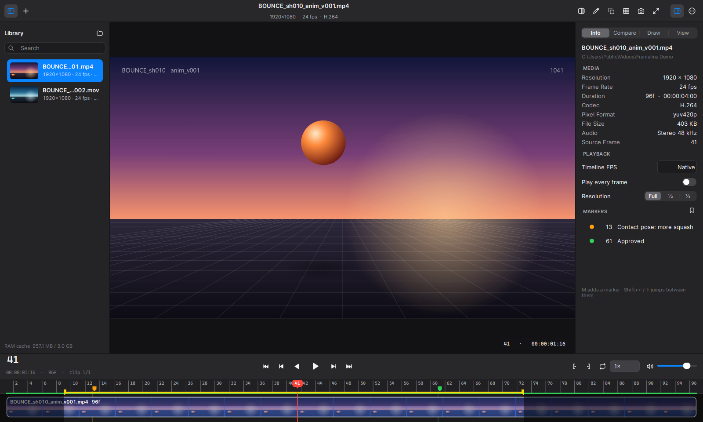
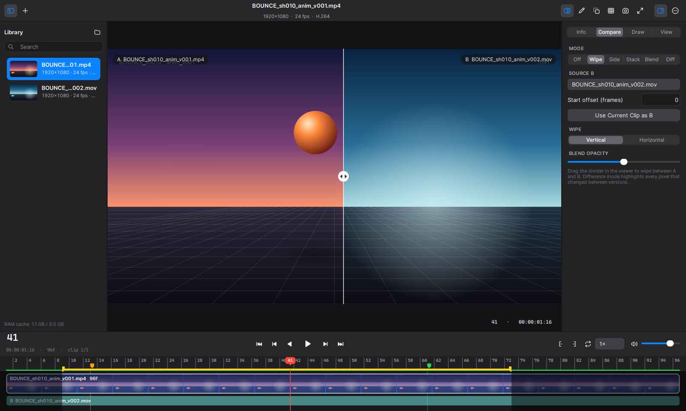

<p align="center"></p>

# Frameline

A frame-accurate media player and review tool for animation and VFX, with a macOS-inspired interface.
Runs on Windows and macOS.

**Designed and built by Miguel Rato.**

<p align="center"></p>

## Screenshots

| | |
| --- | --- |
| <br>**Compare versions** with a draggable wipe, side by side, stacked, blend or difference. | <br>**Draw notes** on any frame with pen, shapes, arrows and text. Notes stay with the source frame. |
| <br>**Onion skin** shows the frames either side of the current one, so you can check spacing and arcs. | <br>**Export a range** as an H.264 MP4 or a GIF at full resolution, with drawings burned in. |
| <br>**Side by side** comparison of two versions. | |

## Download

Get the latest version from the [Releases page](https://github.com/iamgraphicartist/frameline/releases/latest).

| Platform | File |
| --- | --- |
| Windows 10/11 (installer) | `Frameline-Setup-<version>.exe` |
| Windows (portable, no install) | `Frameline-<version>-Windows-Portable.exe` |
| Mac with Apple Silicon (M1 or later) | `Frameline-<version>-macOS-AppleSilicon.dmg` |
| Mac with Intel | `Frameline-<version>-macOS-Intel.dmg` |

### Installing on Windows
Run the installer. It doesn't need admin rights. It adds Frameline to the Start menu and to **Open with** for video files.
- **Make it your default player:** in Frameline open **⋯ → Set as Default Video Player…**, or tick the option at the end of setup. Settings opens on Frameline's page; click **Set default**.
- **"Windows protected your PC":** the app isn't code-signed, so Windows may show this message. Click **More info → Run anyway**.

### Installing on macOS
Open the `.dmg` and drag **Frameline** into **Applications**.
- **First launch:** the app isn't notarised by Apple, so the first time open it with right-click → **Open** → **Open**. On macOS 15 and later, use **System Settings → Privacy & Security → Open Anyway** instead.
- **Make it your default player:** select a video in Finder, press **⌘I**, choose Frameline under **Open with**, then click **Change All…**.

## Features
- **Playback:** H.264/H.265, ProRes, DNxHD, VP9, AV1 and more via FFmpeg, plus image sequences (PNG, JPG, TIFF, EXR, DPX…, numbering detected automatically) and stills. Frames are cached in RAM (a green bar shows what's cached).
- **Transport:** forward and reverse play, J/K/L shuttle, 0.1×–8× speed, step one frame at a time, loop / ping-pong / play-once, in/out play range, timeline FPS override, "play every frame" mode, ½ and ¼ proxy resolution.
- **Timeline:** combine several clips into one sequence, re-order them with Ctrl+drag, set hold length for stills, add colour markers with notes.
- **Compare A/B:** wipe (vertical or horizontal), side-by-side, stacked, blend and difference, with a frame offset for B.
- **Annotate:** pen, line, arrow, rectangle, ellipse, text and eraser, 11 colours, undo/redo. Drawings are saved per source frame and the previous drawing can show as a ghost. Export a snapshot, copy a frame, or export all annotated frames at once.
- **View:** zoom and pan, fit / 100%, dark/black/grey/checker backgrounds, safe areas, rule of thirds, centre cross, aspect masks (1.85, 2.39, 16:9…), onion skin, frame/timecode overlay, pixel readout, presentation mode.
- **Audio:** synced playback, reverse and varispeed, scrubbing, volume and mute.
- **Sessions:** `.flsession` files store clips, markers, annotations and compare setup. There's also a recent-files list, dark/light appearance and always-on-top.
- **Remote API:** off by default. When enabled, other tools on this computer can control the player through JSON on `127.0.0.1:18181`. See `frameline/remote.py`.

Press **F1** in the app to see every keyboard shortcut. On a Mac, use ⌘ where a shortcut says Ctrl.

## Build from source
Needs Python 3.11 or later.
```powershell
python -m venv .venv
.\.venv\Scripts\pip install -r requirements.txt
.\build.ps1                      # Windows: builds dist\Frameline.exe
```
Run without building: `python run.py`

Releases are built automatically by GitHub Actions ([.github/workflows/release.yml](.github/workflows/release.yml)). Push a tag such as `v1.0.1` to publish a new version for Windows and macOS. The version number lives in `frameline/__init__.py`.
